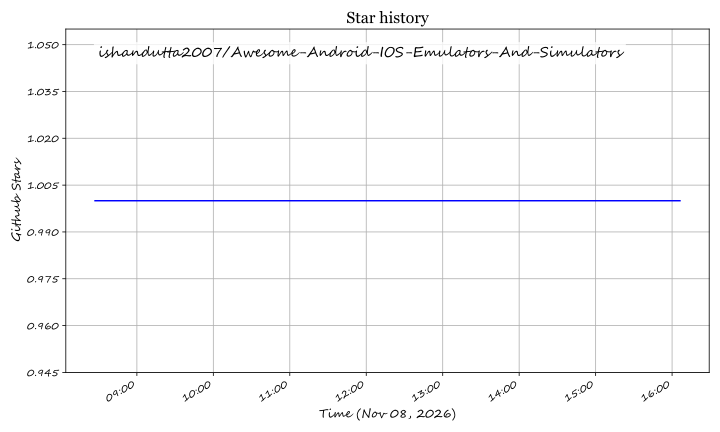

  

# 📱 Awesome Android & iOS Emulators and Simulators

  
  
  
  
  
  

---

> 🚀 **The definitive curated index of SaaS cloud testing platforms and open-source GitHub projects for Android & iOS emulation, browser-based simulator streaming, remote device farms, and low-level virtualization.**

---

## 📑 Table of Contents

- [📊 Sector Overview & Market Dynamics](#-sector-overview--market-dynamics)
- [☁️ SaaS & Hosted Device Clouds](#️-saas--hosted-device-clouds)
- [💻 Open-Source GitHub Projects](#-open-source-github-projects)
- [🛠️ Emulation Architecture Archetypes](#️-emulation-architecture-archetypes)
- [🤝 How to Contribute](#-how-to-contribute)
- [💖 Support & Sponsorship](#-support--sponsorship)
- [📈 Star History](#-star-history)
- [⚠️ Disclaimer](#️-disclaimer)

---

## 📊 Sector Overview & Market Dynamics

The global **Mobile App Testing** market was valued at **$8.6B–$14.8B in 2024** and is projected to expand to **$19.4B–$32B+ by 2030** (~11–17% CAGR), alongside the broader **Cloud Testing** market currently estimated at **$12.4B–$13.1B**.

Market concentration across mobile testing infrastructure is **fragmented to moderately concentrated**:
- While large legacy testing consultancies and top enterprise SaaS giants (e.g. BrowserStack, Sauce Labs) secure major enterprise accounts, the category lacks a single monopolistic "winner-take-all" winner.
- Continuous proliferation of fragmented mobile operating system versions, specialized ARM-based virtualization architectures (e.g. Corellium), WebRTC low-latency streaming layers, and modular open-source frameworks (Appium, Dockerized AOSP, scrcpy) creates sustained market opportunities for agile niche players and self-hosted on-premises solutions.

---

## ☁️ SaaS & Hosted Device Clouds

Commercial cloud device farms, managed browser streaming platforms, and proprietary virtualization vendors, **ranked and sorted in descending order by estimated company valuation / scale**:

| 🏢 Product | 💰 Company Valuation / Scale | 🏷️ Starting Pricing | ⏱️ Free Tier / Trial Limits | 🎯 Best For / Key Trade-off |
| :--- | :--- | :--- | :--- | :--- |
| **[BrowserStack](https://www.browserstack.com/)** | **~$4.0B Valuation** *(~$225M+ ARR)* | • **App Live (Manual):** Starts at **$39/mo** (billed annually) or **$49/mo** (monthly) for 1 user seat. • **App Automate:** Starts at **$199/mo** (billed annually) or **$249/mo** (monthly) for 1 parallel test run. | • **No permanent free tier** for mobile testing. • **App Live Free Trial:** 30 total minutes across real devices (~1 min per session). • **App Automate Free Trial:** 100 automated testing minutes. • Free plan available for qualifying open-source projects. | **Best for:** Teams requiring real-device parity and cross-platform mobile testing. **Trade-off:** Costs scale quickly with parallel test threads. |
| **[Sauce Labs](https://saucelabs.com/)** | **~$613M Valuation** *(~$92M ARR, $150M+ funding)* | • **Live Testing (Manual):** Starts at **$39/mo** (billed annually) or **$49/mo** (monthly). • **Virtual Device Cloud:** Starts at **$149/mo** (billed annually) or **$199/mo** (monthly). • **Real Device Cloud:** Starts at **$199/mo** (billed annually) or **$249/mo** (monthly). | • **No permanent free tier**. • **28-Day Free Trial:** 60 automated & live testing minutes, up to 3 parallel virtual machines. • Free sponsorship tier available for public open-source repositories. | **Best for:** Large enterprise organizations needing unified mobile virtual/physical grids and compliance. **Trade-off:** Inflexible pricing packages for smaller development teams. |
| **[LambdaTest](https://www.lambdatest.com/)** | **~$400M Valuation** *(Series D, $108M funding)* | • **Live Testing (Virtual):** Starts at **$15/mo** (billed annually) or **$19/mo** (monthly). • **Automation Testing:** Starts at **$79/mo** (billed annually) or **$99/mo** (monthly). • **HyperExecute:** Starts at **$159/mo** (billed annually). | • **Free Forever Plan:** 60 lifetime minutes of live testing (capped at 10-minute sessions), 100 automation minutes, and 2,000 SmartUI visual testing screenshots per month. | **Best for:** Cost-conscious engineering teams wanting affordable cloud emulators and fast test execution. **Trade-off:** Physical real-device access requires costlier add-ons. |
| **[Corellium](https://www.corellium.com/)** | **~$170M Valuation** *(Acquired by Cellebrite; $25M funding)* | • **Solo Explorer Tier:** Starts at **$3.00 per device-hour**. • **Enterprise / Viper:** Annual plans starting at **$9,995/year** (bundles ~1,250 device-hours/mo). | • **No permanent free tier**. • **Free Trial:** Available by request on a case-by-case basis (requires manual verification); Arm Virtual Hardware (AVH) provides 30-day evaluation with 100 core-hours. | **Best for:** Mobile security researchers, firmware analysts, and pentesting teams requiring rooted iOS/Android virtualization. **Trade-off:** High starting price point; requires specialized OS security knowledge. |
| **[BlueStacks](https://www.bluestacks.com/)** | **~$50M–$100M+ Est. Valuation** *(~$30M–$50M ARR, $48M+ funding, now.gg parent)* | • **Free with ads**. • **BlueStacks Prime (Ad-Free):** **$7.99/mo** (removes display ads, bundles 800 nowBux and 5,000 AI credits monthly). | • **Free Forever Tier:** Ad-supported free tier with unlimited play time and multi-instance virtualization support. | **Best for:** Desktop gaming and casual app simulation on PC and Mac. **Trade-off:** Heavy advertising on free tier; not architected for automated CI/CD developer pipelines. |
| **[NoxPlayer](https://www.bignox.com/)** | **~$35M–$60M+ Est. Valuation** *(Duodian Network / Nox Group, $31.6M Series B)* | • **Free with ads**. • **NoxPlayer Premium (VIP):** Starts at **$3.69/mo**, **$9.99/quarter**, or **$31.99/year** (removes launcher banner and startup ads across up to 5 instances). | • **Free Forever Tier:** Ad-supported free tier with unlimited local virtualization usage and multi-instance support. | **Best for:** Gamers and everyday users wanting a lightweight Android desktop gaming emulator. **Trade-off:** Free tier contains launcher banners and sponsored app promotions; not intended for developer QA automation. |
| **[Genymotion Cloud](https://www.genymotion.com/)** | **~$20M–$30M Est. Valuation** *(Genymobile, ~$6M ARR, $9.7M funding)* | • **Genymotion SaaS (Pay-as-you-go):** **$0.05 per minute** per active virtual device (no base subscription fee). • **Cloud Marketplace (AWS/GCP/Azure):** Hourly PaaS software fees from **~$0.50/hour** + cloud compute costs. | • **Genymotion SaaS Trial:** 60 free minutes total, capped at 2 concurrent virtual devices. • **GCP Marketplace Trial:** 5-day trial with $60 Genymotion software credit (infrastructure charges still apply). | **Best for:** Engineering teams and automated CI pipelines needing scalable, API-driven cloud Android emulation. **Trade-off:** Android-only; iOS devices and simulators are completely unsupported. |
| **[Appetize.io](https://appetize.io/)** | **~$10M–$20M Est. Valuation** *(Bootstrapped profitable niche leader)* | • **Starter Plan:** **$59/mo** (billed monthly) or **$50/mo** (billed annually), includes 500 streaming minutes ($0.06/min overage). • **Premium Plan:** Starts at **$199/mo** (billed monthly). | • **Free Forever Tier:** 30 minutes per month total, capped at 3 minutes per session, and up to 2 concurrent active device streams. | **Best for:** Embedding interactive iOS & Android app demos directly in web browsers, product documentation, or customer support. **Trade-off:** Geared towards streaming and manual demos rather than end-to-end automated testing matrixes. |
| **[Xcode Simulator](https://developer.apple.com/xcode/)** | **Parent: Apple Inc. (~$3.5T Market Cap)** | • **100% Free** with Apple ID and Xcode on macOS. | • **Free Forever:** Unlimited local simulation without time limits, session restrictions, or license costs. | **Best for:** Native iOS, iPadOS, watchOS, and tvOS development with swift compilation and deep framework debugging. **Trade-off:** Strictly macOS-exclusive; requires high local disk overhead (15GB+). |
| **[Android Studio AVD](https://developer.android.com/studio)** | **Parent: Alphabet / Google (~$2.1T Market Cap)** | • **100% Free** (Open-source SDK tools and system images bundled with Android Studio). | • **Free Forever:** Unlimited local usage without any time limits, session caps, or licensing fees. | **Best for:** Native Android developers wanting official Google Play Services, CTS compliance, and latest API levels. **Trade-off:** High local CPU/RAM memory footprint; no iOS simulation. |

---

## 💻 Open-Source GitHub Projects

Curated list of self-hosted mobile emulators, containerized virtualization environments, simulator streaming tools, and open-source device farms, **ranked and sorted in descending order by GitHub_Stars**:

| 📦 Repository & Link | 🌟 GitHub_Stars_Badge | 📜 License | 💡 Architecture / Focus |
| :--- | :--- | :--- | :--- |
| **[Genymobile/scrcpy](https://github.com/Genymobile/scrcpy)** |  | Apache-2.0 | Ultra-low-latency display and control of physical Android devices over USB/TCP without requiring root. |
| **[budtmo/docker-android](https://github.com/budtmo/docker-android)** |  | MIT | Complete Dockerized Android emulator image with noVNC browser access, video recording, and Appium support. |
| **[openstf/stf](https://github.com/openstf/stf)** |  | Apache-2.0 | The foundational Smartphone Test Farm for controlling and managing Android device fleets from your browser. |
| **[waydroid/waydroid](https://github.com/waydroid/waydroid)** |  | GPL-3.0 | Container-based approach to run a full Android system on Linux using native host kernel namespaces (near-native speed). |
| **[anbox/anbox](https://github.com/anbox/anbox)** |  | GPL-3.0 | Groundbreaking container-based Android runtime system placing Android into an LXC container integrated with Linux. |
| **[remote-android/redroid-doc](https://github.com/remote-android/redroid-doc)** |  | Apache-2.0 | Remote Android in Docker (ReDroid) — GPU-accelerated cloud Android instance platform (supports KVM, Mesa, and multiple Android versions). |
| **[DeviceFarmer/stf](https://github.com/DeviceFarmer/stf)** |  | Apache-2.0 | Community-maintained active fork of OpenSTF with modern Node.js, security updates, and device compatibility. |
| **[touchHLE/touchHLE](https://github.com/touchHLE/touchHLE)** |  | GPL-3.0 | High-level iPhone OS emulator written in Rust; emulates UIKit, OpenGL ES, and dynarmic CPU for classic 32-bit iOS games. |
| **[google/android-emulator-container-scripts](https://github.com/google/android-emulator-container-scripts)** |  | Apache-2.0 | Official Google container scripts for packaging Android SDK system images and running headless emulators in Docker with WebRTC. |
| **[jo-duchan/tapflow](https://github.com/jo-duchan/tapflow)** |  | MIT | Self-hosted BrowserStack/Appetize alternative streaming iOS simulators and Android emulators via WebCodecs/H.264 with MCP server support. |
| **[AppiumTestDistribution/appium-device-farm](https://github.com/AppiumTestDistribution/appium-device-farm)** |  | Apache-2.0 | Appium 2.0 plugin designed to dynamically manage, schedule, and allocate local and remote mobile devices across test runs. |
| **[Shmayro/dockerify-android](https://github.com/Shmayro/dockerify-android)** |  | MIT | Dockerized Android emulator supporting x86 and arm64 with scrcpy-web browser interface, ADB bridging, and Magisk root support. |
| **[shamanec/GADS](https://github.com/shamanec/GADS)** |  | AGPL-3.0 | Mobile device farm facilitating remote control and automated Appium testing across both iOS and Android connected hardware. |
| **[samhenrigold/LightTouchMac](https://github.com/samhenrigold/LightTouchMac)** |  | GPL-3.0 | QEMU-iOS based emulator for macOS running classic iPhone, iPod touch, and iPad operating systems (iOS 1.x through 7.1.2). |
| **[Musaddiq-Sultan/NixDroid](https://github.com/Musaddiq-Sultan/NixDroid)** |  | GPL-3.0 | Native-performance x86_64 AOSP emulator for Linux utilizing QEMU virtualization to eliminate software translation overhead. |

---

## 🛠️ Emulation Architecture Archetypes

Understanding the architectural distinction between these platforms is critical when planning test infrastructure:

1. **🌐 Real Device Cloud Farms (BrowserStack, Sauce Labs, LambdaTest)**
   - Maintain thousands of physical smartphones connected to USB hubs in centralized data centers.
   - Best for OEM-specific hardware testing (Samsung OneUI, Xiaomi MIUI, camera/biometric sensor validation).

2. **🖥️ Self-Hosted Simulator & Web Streaming (tapflow, GADS, OpenSTF/DeviceFarmer)**
   - Streams video output via WebRTC or WebCodecs H.264 directly from your internal macOS/Linux build servers to browser clients.
   - Ideal for teams with internal security restrictions or strict data sovereignty guidelines preventing cloud artifact uploads.

3. **🐳 Containerized Android Emulators (docker-android, ReDroid, dockerify-android)**
   - Encapsulates Android virtual devices inside Docker containers leveraging KVM hardware virtualization on Linux nodes.
   - Perfect for automated CI/CD pull-request validation pipelines in Kubernetes clusters.

4. **🕹️ High-Level & Classic Emulators (touchHLE, LightTouchMac)**
   - Re-implements legacy iOS binaries and libraries (UIKit, OpenAL) or wraps QEMU ARM models for historic preservation.
   - Designed for retro gaming and preservation rather than modern 64-bit production QA.

5. **🔬 Micro-Architectural Virtualization (Corellium)**
   - Models genuine ARM-based SoC hardware at the hypervisor level to run genuine Apple iOS and Android kernel builds.
   - The gold standard for zero-day vulnerability research, malware analysis, and kernel exploration.

---

## 🤝 How to Contribute

Contributions are welcome! Please follow these guidelines:

1. 🍴 Fork the repository.
2. 🌿 Create a feature branch: `git checkout -b feature/awesome-addition`
3. 📝 Update `README.md` with:
   - Tool name and clean canonical website/repository link.
   - Accurate starting pricing or GitHub Stars_Count badge.
   - Explicit free tier / trial limitations or license details.
   - Architectural strengths and trade-offs.
4. 🚀 Commit your changes and open a descriptive Pull Request.

---

## 💖 Support & Sponsorship

If you find this curated matrix useful for your development workflow, mobile infrastructure, or research, please consider supporting the project:

- 🌟 **Star the repository** to help others discover it!
- 🍴 **Fork the repo** to contribute your own benchmark insights.
- 📢 **Share the project** with your engineering team, mobile DevOps group, and QA communities.
- ☕ **Buy me a coffee / Sponsor the project:** Support ongoing maintenance, documentation, and tooling updates directly on GitHub Sponsors:

  

---

## 📈 Star History

---

## ⚠️ Disclaimer

- This curated directory is maintained for informational and educational purposes. Mentions do not constitute an endorsement.
- All product names, logos, and brands are property of their respective owners.
- Ensure that any mobile emulation platform handling proprietary binaries and user data adheres to your organizational compliance, privacy policies (GDPR/CCPA), and developer terms of service.

## ⭐ Star History

<a href="https://star-history.com/#ishandutta2007/Awesome-Android-IOS-Emulators-And-Simulators&Timeline" align="center">
  <picture>
    <source media="(prefers-color-scheme: dark)" srcset="assets/ishandutta2007_Awesome-Android-IOS-Emulators-And-Simulators_growth.svg">
    
  </picture>
</a>
